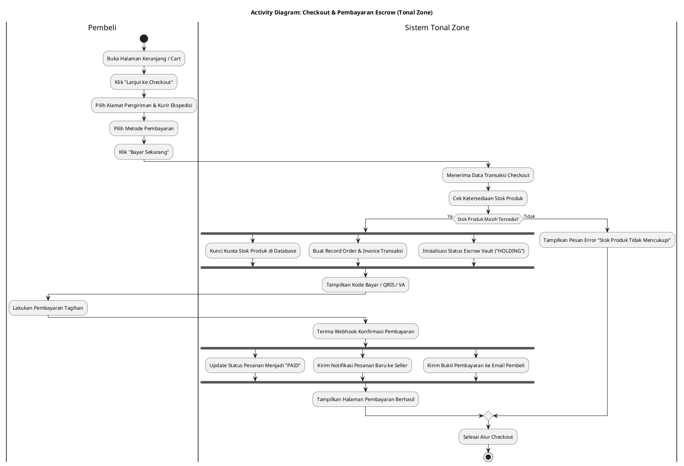
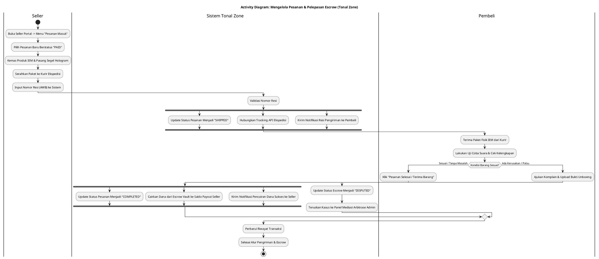
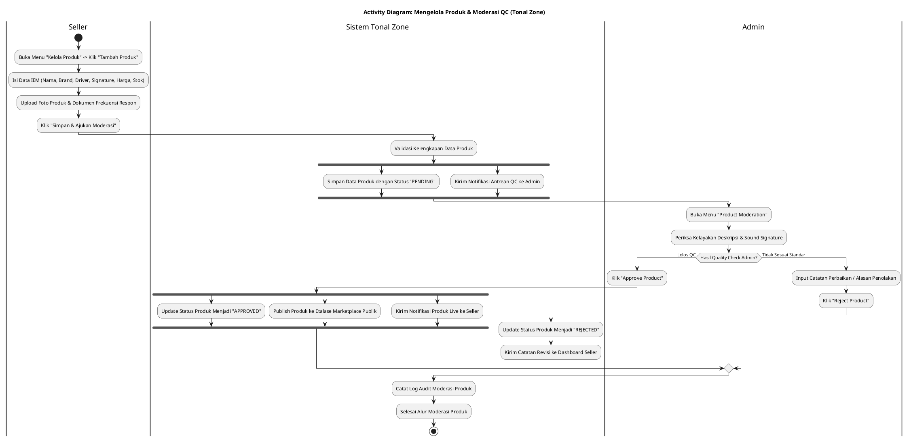
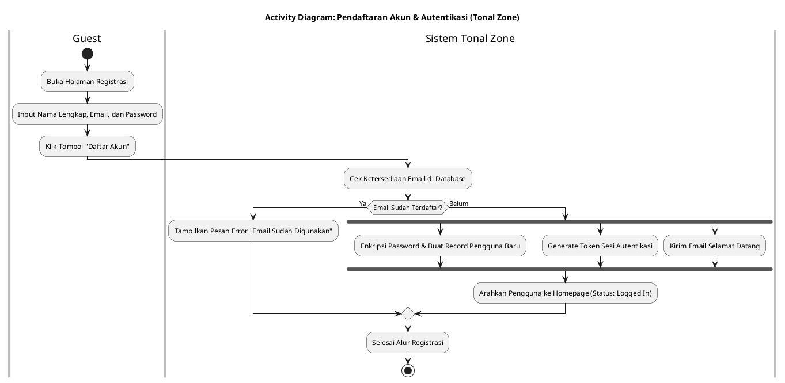

# Activity Diagrams - Tonal Zone Marketplace

Dokumentasi resmi Activity Diagram untuk sistem e-commerce & marketplace IEM **Tonal Zone**.
Semua diagram mematuhi standar UML dengan aturan:
1. **Single Endpoint:** Setiap diagram hanya memiliki **1 titik mulai (start)** dan **1 titik akhir (stop)**. Seluruh cabang keputusan (sukses/gagal/ditolak) digabungkan kembali (*merged*) ke satu *endpoint*.
2. **System-Only Fork & Join:** Elemen konkurensi (`fork` dan `join`) **hanya berada di dalam swimlane `Sistem`**. Aksi aktor manusia berjalan sekuensial.

---

## 1. Activity Diagram: Checkout & Pembayaran Escrow

Diagram ini memodelkan proses checkout oleh Pembeli, penguncian stok, pembuatan rekening penampung (*Escrow Vault*), hingga konfirmasi pembayaran.

---

## 2. Activity Diagram: Membuka Toko & Verifikasi Seller (KYC)

Diagram ini memodelkan pengajuan pembukaan toko oleh pengguna, verifikasi berkas legalitas/KYC oleh Admin, dan aktivasi merchant.

---

## 3. Activity Diagram: Mengelola Pesanan Masuk & Pengiriman (Fulfillment)

Diagram ini memodelkan proses pemenuhan pesanan oleh Seller, input nomor resi kurir, pemantauan pengiriman, masa inspeksi 2x24 jam, hingga pelepasan dana *Escrow* ke *Seller*.

---

## 4. Activity Diagram: Mengelola Produk & Moderasi QC

Diagram ini memodelkan input katalog IEM oleh Seller dan proses Quality Check (QC) oleh Admin sebelum produk tayang di etalase publik.

---

## 5. Activity Diagram: Pendaftaran Akun & Autentikasi

Diagram ini memodelkan registrasi akun baru oleh Guest dan pembuatan token autentikasi.

